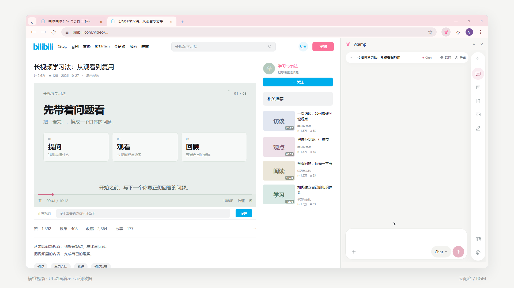
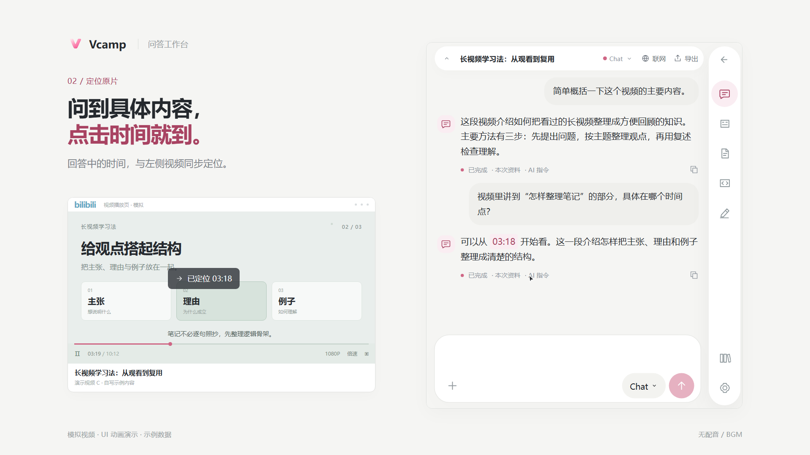
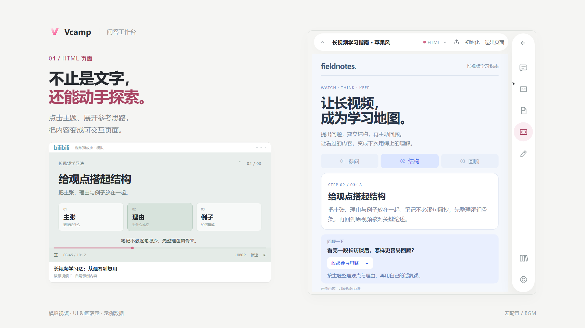
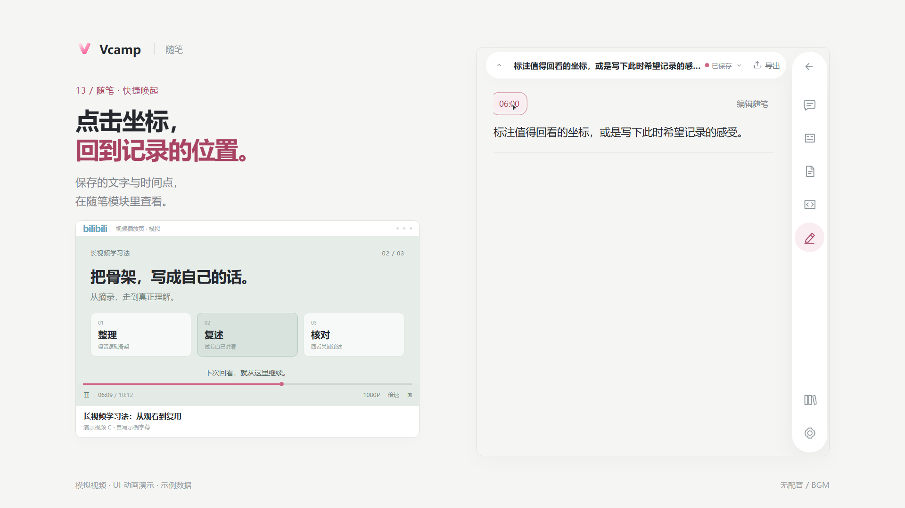
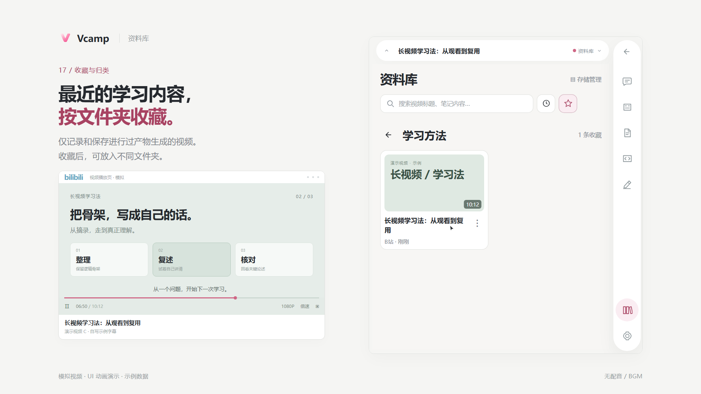

# Vcamp

**围绕视频，提问、整理、生成。**

Vcamp 是 Chrome 侧栏中的视频学习工作台。以 Bilibili 视频的可用字幕为基础，把观看过程中的问题、笔记和想法留在一起，生成便于回顾的文字文档与 HTML 学习页。

**v1.0.0** · [下载安装包](https://github.com/lamzihin334455-creator/Vcamp/releases/download/v1.0.0/Vcamp-1.0.0.zip) · [校验值](https://github.com/lamzihin334455-creator/Vcamp/releases/download/v1.0.0/SHA256SUMS.txt) · [安装教程](docs/install.md) · [使用说明](docs/usage.md) · [Release 与验收](https://github.com/lamzihin334455-creator/Vcamp/releases/tag/v1.0.0)

免费开源；AI 功能使用你自己的 API Key，费用由服务商收取。资料保存在本机，没有项目自建账号或云同步。支持桌面 Chrome/Chromium 149 及以上。



> 本页及使用说明中的图片来自 Remotion 功能演示，界面为演示重建，字幕、问题和回答为自编示例数据；用于说明功能与操作位置，不是扩展实录或模型实测结果。实际效果取决于视频资料、模型和请求内容。图片来源见 [素材说明](docs/images/README.md)。

## 可以用它做什么

| 功能 | 你可以做的事 |
| --- | --- |
| 字幕阅读 | 跟随播放、点击时间点回看，设置主字幕与辅助语言、独立字号；使用模型翻译或修正字幕 |
| 视频问答 | 直接提问，或选用模板整理内容；通过回答中的有效视频时间点回到对应片段核对 |
| Markdown 笔记 | 把视频内容整理成可阅读、可继续编辑的文档 |
| HTML 学习页 | 选择风格与页面要求，生成可在沙箱中打开和操作的页面 |
| 随笔 | 记录自己的想法，附上当前视频时间点，方便再次回看 |
| 资料库 | 查找已保存资料，使用收藏文件夹整理，并导出资料或完整备份 |

## 功能预览

### 带着问题看，回到原片核对

在同一个输入框里提问；需要定位时，询问具体片段并点击回答中的时间点。字幕、问答和生成内容围绕当前视频组织。



[字幕阅读、双语与 AI 处理](docs/usage.md#字幕阅读与定位) · [问答与时间点](docs/usage.md#视频问答)

### 把内容整理成笔记和交互页面

输入框下方可以选择 Chat、笔记或 HTML。笔记支持继续阅读与编辑；选择 HTML 后可切换页面风格，生成完成后从回答中打开。



[Markdown 笔记](docs/usage.md#生成-markdown-笔记) · [HTML 页面与风格](docs/usage.md#生成-html-学习页)

### 按自己的习惯提问和记录

使用 `@` 选择任务模板；角色用于设置回答的详略与侧重点，也可自定义角色身份和表达风格。临时想到的问题，可以用 `!` 唤起“写随笔”，附带视频时间点保存。



[角色与模板](docs/usage.md#角色与任务模板) · [记录随笔](docs/usage.md#记录随笔)

### 把资料留在自己的工作台

从资料库找回已保存内容，用收藏与文件夹整理。阅读资料可按需导出；迁移或升级前，另行下载完整的 `.vcamp` 备份。



[资料库、导出与备份](docs/usage.md#资料库导出与备份)

## 开始使用

1. **安装插件**：下载正式 ZIP 与校验文件，核对后解压。在 `chrome://extensions` 开启开发者模式，选择“加载已解压的扩展程序”。不要把 GitHub 自动生成的 Source code ZIP 当作安装包。详见 [安装教程](docs/install.md)。
2. **打开视频**：进入有可用字幕的 Bilibili 视频页，点击 Vcamp 扩展图标打开侧栏，确认字幕已就绪。
3. **配置模型**：在“设置 → API 设置”保存服务连接，拉取模型，勾选并录入需要的模型。只拉取列表还不能开始使用；也可以按 [API 配置](docs/api-settings.md) 手动录入模型。
4. **提问或生成**：直接输入问题，或用 `@` 选择模板；需要文档时，在输入框下方选择笔记或 HTML，再填写要求并发送。
5. **回顾与备份**：从回答中打开生成内容，在资料库整理和导出；更新前保留旧包并导出 `.vcamp` 备份，不要先卸载扩展。

完整图文流程见 [使用说明](docs/usage.md)。

## 角色与任务模板

默认角色依次为：**简洁直接、标准、深度分析、通俗易懂**。在“角色设置 → 应用范围”中开启后，笔记和 HTML 也会使用当前角色的表达偏好；已发送的请求保留原设置。

| 默认模板 | 输出类型 |
| --- | --- |
| 快速总结 | Chat |
| 坐标传送门 | Chat |
| 健康度检测 | Chat |
| 独立阅读文档 | Markdown |
| 风格化交互页面 | HTML |

角色与模板都可编辑。默认配置依据见 [内置目录](docs/release/default-presets.md)。

## 使用范围

- 当前视频流程主要面向 Bilibili 的可用字幕。无字幕时不承诺自动完整转写或理解整段视频；生成内容需要结合原片核对。
- 支持 DeepSeek、阿里云百炼、商汤日日新及自定义 OpenAI 兼容 HTTPS 服务。第三方连接目前仅开放文本；视觉和联网仅在满足条件的 DeepSeek 官方连接下提供。详见 [API 配置](docs/api-settings.md)。
- HTML 在限制联网和宿主访问的沙箱中运行。页面的内容与交互由本次生成决定，图中布局不代表固定生成结果。
- 资料保存在当前浏览器的扩展身份下；换路径、换 profile 或卸载可能使原资料无法直接显示，先做备份。

## 开发与构建

使用 [.node-version](.node-version) 指定的 Node.js 和 npm 11：

```sh
cd extension
npm ci --ignore-scripts
npm run typecheck
npm test
npm run build
npm run licenses
npm run package
```

生产 ZIP、SHA-256 与构建清单输出至根目录 `out/`。执行 `npx playwright install chromium` 后运行 `npm run test:e2e` 进行浏览器回归。默认测试使用合成数据和受控响应，不需要真实 API Key。

## 文档与许可

- [图文使用说明](docs/usage.md) · [安装、升级与恢复](docs/install.md) · [API 配置与故障排查](docs/api-settings.md)
- [架构与信任边界](docs/architecture.md) · [发布范围](docs/release-scope.md)
- [隐私说明](PRIVACY.md) · [安全报告](SECURITY.md) · [贡献指南](CONTRIBUTING.md)
- [变更记录](CHANGELOG.md) · [Standards 审查](docs/release/standards-review.md) · [Spec 审查](docs/release/spec-review.md)

自有代码以 [MIT](LICENSE) 发布，依赖保留各自许可证，见 [第三方声明](THIRD_PARTY_NOTICES.md)。`promo-video/` 为独立的演示制作工程，其 Remotion 使用条件与扩展运行时分别管理。
