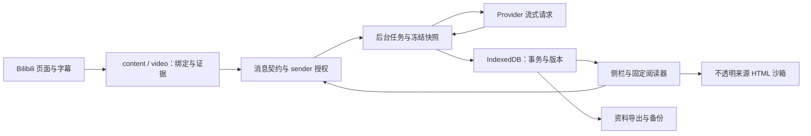

# 架构与数据流

本文描述 v1.0 发布工程实现。历史 PRD 与决策文档包含旧方案，支持范围以 `release-scope.md` 和当前契约为准。

| 模块 | 责任与边界 |
| --- | --- |
| contracts | Zod 消息和持久数据契约，字段及容量限制 |
| app | 应用会话、消息路由、UI，sender 与阅读器固定资源授权 |
| content、video | 页面观察、字幕、画面采样，页面数据视为不可信 |
| generation | Provider 能力、规划、流式解析、取消和诊断 |
| data | IndexedDB v10、任务冻结、不可变版本、归属与原子恢复 |
| library、workbench | 资料查询、引用、导出和工作区 |
| html | 校验、沙箱包装、来源令牌及受控时间导航 |
| brand | 本地启动动效，无视频编辑器运行时 |
| tests | 单元、集成、隔离浏览器、合成媒体及单独启用的真实服务测试 |

UI 保存草稿后，后台按当前视频、字幕和所选资料冻结请求。能力在后台再次校验，文本模型不能静默丢弃历史图片。任务维护尝试、序号、取消与完成状态，流式片段保存检查点，最终形成对话或资料版本。视频或配置切换不会把旧任务改送新配置。

学习资料在 IndexedDB；API 凭据在仅可信扩展上下文可读的 `chrome.storage.local`，不进入备份。该存储不是系统加密保险箱，本机开发工具属于信任边界。固定阅读器仅读取指定资源；导出合并保持显式选择集合，只有显式 `*` 代表全部涂写。备份生成和恢复均校验图结构和容量。

HTML 可执行页内脚本，由不透明来源 iframe、CSP 和受限桥隔离。内容真实性和 CPU/内存消耗无法完全保证。模型异常只保留有限结构化诊断；用户决定是否重试，限流不会触发自动付费重试。

构建分 production、test-extension、capture-test。生产包通过白名单检查；`executor.html` 是任务执行入口，不能删除。测试构建包含 seed/probe 及本机 HTTP 权限，不得分发。`promo-video/` 是独立制作工具链。
