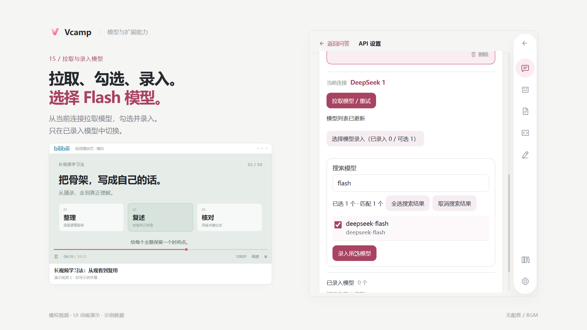
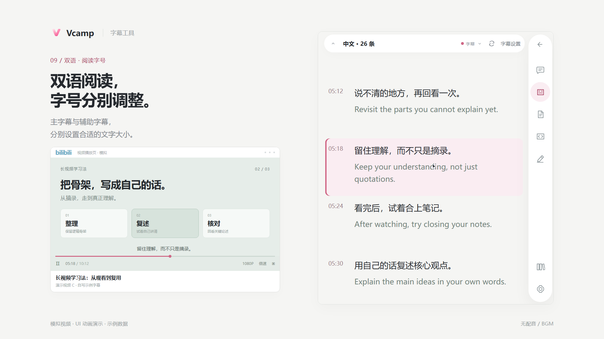
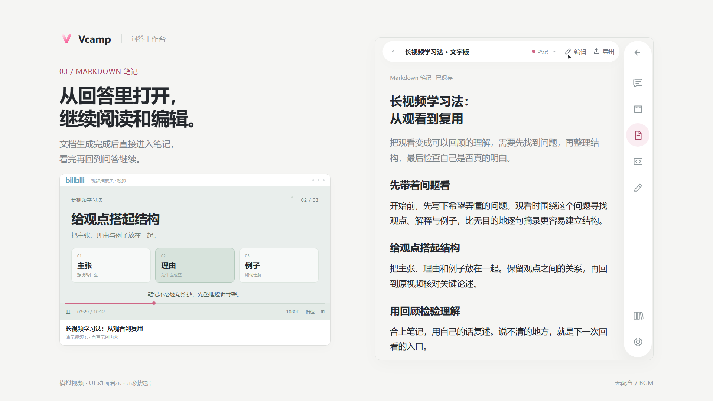
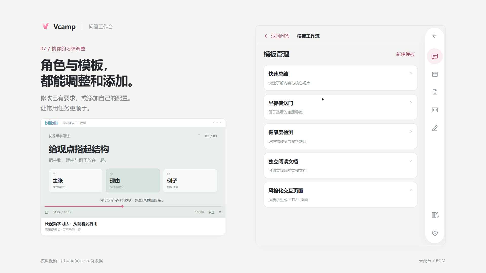

# 使用说明

[返回 README](../README.md) · [安装与更新](install.md) · [API 配置](api-settings.md)

下图取自 Remotion 功能演示，使用重建界面与自编示例数据，用于指认功能和操作位置，不是插件实录或模型实测案例。实际界面以安装的版本为准；素材来源见 [图片说明](images/README.md)。

## 首次打开

1. 按 [安装教程](install.md) 加载正式插件。
2. 打开一个有可用字幕的 Bilibili 视频页，点击浏览器工具栏中的 Vcamp 图标。
3. 等待当前视频和字幕就绪。视频切换、分 P 切换后，先核对侧栏对应的是当前内容。
4. 首次使用 AI 功能时，完成下面的模型配置。阅读站点已有字幕不需要先调用模型；翻译、修正和生成需要可用连接。

## 连接服务与录入模型

1. 打开设置菜单，进入 **API 设置**。
2. 在 **连接服务** 中选择服务商，填写自己的 API Key，保存连接。自定义服务填写其 OpenAI 兼容 HTTPS Base URL，具体格式见 [API 配置](api-settings.md)。
3. 在 **管理模型** 中选择该连接，点击 **拉取模型 / 重试**，勾选要使用的模型，再点击 **录入所选模型**。
4. 确认模型已经录入、当前模型可用，再返回问答。服务没有目录接口时，可以在“更多设置”中手动录入完整模型 ID。

模型目录读取成功不等于实际调用已有权限。认证、余额、限流及模型权限问题，按 [API 故障排查](api-settings.md#拉取失败) 检查。安装包不附带 Key，完整资料备份也不包含 Key。

## 字幕阅读与定位

- 打开侧栏的 **字幕** 模块，查看站点提供的字幕。播放时可跟随当前字幕；点击字幕时间点，返回原视频对应位置。
- 在 **字幕设置** 中选择主字幕、辅助字幕语言，并分别设置字号。可选轨道取决于当前视频和已保存的处理结果。
- 需要译文或纠正识别错误时，在字幕设置中使用 **AI 翻译** 或 **AI 字幕修正**。这会请求所选服务；完成后查看保存结果，核对修正前后文本。
- 字幕没有就绪时，先核对站点是否提供字幕、当前页面、网络和登录状态；不要把 AI 修正理解为对无字幕视频的完整语音转写。

## 视频问答

1. 回到 **问答**，确认当前视频与所选模型。
2. 直接输入问题，例如要求解释某个观点、概括一段内容，或定位某个论述出现的时间。
3. 保持输出类型为 **Chat**，发送后等待回答。需要核对时，点击回答中的有效视频时间点，回到原片。
4. 继续追问，或切换为笔记、HTML 来整理内容。回答是否包含准确时间点取决于可用资料与模型，应以原视频核对。

输入框支持 Enter 发送、Shift+Enter 换行。输入 `@` 可以选择模板；“更多输入操作”也提供相应入口。

## 生成 Markdown 笔记

1. 在问答输入框下方打开产物类型菜单，选择 **Markdown 笔记**；也可以用 `@` 选择 **独立阅读文档** 模板。
2. 输入整理要求，发送后等待完成。已选择模板时，输出类型由模板决定；要手动更换类型，先移除模板标签。
3. 从回答中点击 **打开笔记**，进入文档继续阅读或编辑；通过侧栏导航返回问答。
4. 使用导出功能保存可阅读文件；需要迁移全部资料时，另做完整备份。

## 生成 HTML 学习页

1. 在产物类型菜单选择 **HTML 页面**，或使用 **风格化交互页面** 模板。
2. 写清页面目标，例如希望按主题组织、设置可展开的解释，或通过自测问题帮助回顾。
3. 在输入框下方选择可用 HTML 风格，再发送请求；生成完成后，从回答中打开页面。
4. 在页面内操作生成的控件，检查内容和交互是否符合要求。布局、按钮与参考思路来自本次生成，并非固定页面模板。

HTML 在沙箱中运行，自动联网和宿主访问受到限制。模型未完整输出或请求失败时，应查看错误原因；不要把半成品当作已完成页面。见 [安全说明](../SECURITY.md)。

## 角色与任务模板

- **角色决定表达偏好**：默认依次为简洁直接、标准、深度分析、通俗易懂。设置回答的详略与侧重点，也可自定义角色身份和表达风格。
- **模板决定任务要求**：在输入框输入 `@` 选择模板；通过设置菜单的 **模板工作流** 查看、编辑或新建模板。
- 默认模板依次为快速总结、坐标传送门、健康度检测、独立阅读文档、风格化交互页面，输出分别为 Chat、Chat、Chat、Markdown、HTML。
- 默认角色仅用于问答。在 **角色设置 → 应用范围** 开启后，笔记和 HTML 也使用当前角色的表达偏好；已发送请求继续保留发送时的设置。

## 记录随笔

1. 在问答输入框输入 `!`，选择 **写随笔**；也可以从“更多输入操作”进入。
2. 输入自己的想法，确认随笔与时间点标签。可以移除时间点，保留不绑定时间的文字。
3. 发送后打开 **随笔** 模块查看记录；有时间点的随笔可以点击坐标回到视频。

随笔保存是本地操作，不需要为了记录自己的文字请求模型。Enter 保存当前随笔，Shift+Enter 换行。

## 资料库、导出与备份

1. 从侧栏打开 **资料库**，查看最近的视频、分 P 和已保存资料。
2. 在条目菜单中使用 **收藏** 或 **添加到文件夹**，按主题组织；在收藏夹中重新找到资料。
3. 打开视频的资料列表，按类别选择问答、笔记、HTML、随笔或字幕等内容，使用 **导出资料** 选择可用格式和下载方式。
4. 需要迁移、升级或防止本机资料丢失时，进入 **资料库 → 存储管理 → 备份与恢复**，点击 **下载资料备份**，导出完整 `.vcamp` 文件并保留。导出阅读文件与完整备份用途不同。

Key 不在备份中；换浏览器或扩展身份后需要重新配置。更新前先备份，替换原目录后重新加载，不要先卸载，详见 [更新、身份与恢复](install.md#更新身份与恢复)。

## 常见问题

| 现象 | 先检查 |
| --- | --- |
| 打开视频后没有字幕 | 当前视频、分 P、站点字幕是否可用，以及登录和网络状态 |
| 模型列表拉取成功，但无法选择或发送 | 是否已勾选录入、当前模型是否支持文本、连接是否可用 |
| 发送按钮不可用 | 字幕是否就绪、输入是否保存、当前对话是否已有任务、模板与模型是否可用；同时查看界面提示 |
| 选择模板后无法改输出类型 | 模板绑定产物类型，移除模板标签后再手动选择 |
| API 返回认证、权限、余额或限流错误 | 按 [API 配置与故障排查](api-settings.md) 核对服务地址、账号、模型权限与额度 |
| 升级后资料没有出现 | 先确认安装路径、浏览器 profile 与扩展 ID，再按 [恢复说明](install.md) 处理 |

提交问题时请勿附上 API Key、个人备份或含隐私的完整截图；漏洞使用 [私密安全报告](../SECURITY.md) 渠道。
